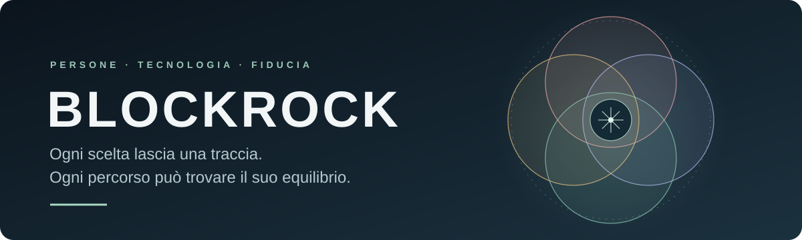
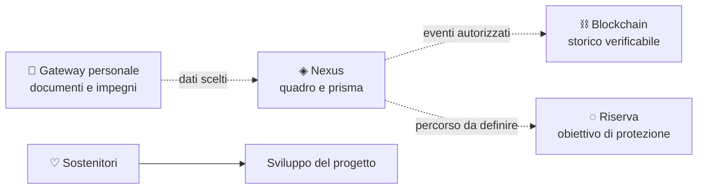

  

  <strong>Un percorso personale. Una storia verificabile. Più spazio per il futuro.</strong>

  <a href="#la-visione">La visione</a> &nbsp;·&nbsp;
  <a href="#perché-la-blockchain">La blockchain</a> &nbsp;·&nbsp;
  <a href="#come-si-collegano-i-pezzi">L’ecosistema</a> &nbsp;·&nbsp;
  <a href="#a-che-punto-siamo">Il progetto oggi</a> &nbsp;·&nbsp;
  <a href="#inizia-da-qui">Documentazione</a>

---

## La visione

La vita è fatta di scelte, impegni e conseguenze che attraversano più ambiti.
Una bolletta imprevista può essere pagata, ma richiedere la rinuncia a qualcosa
per la casa. Un accordo può impegnare risorse che servirebbero altrove.

**BlockRock nasce per dare una forma leggibile a queste relazioni** e accompagnare
la persona verso una maggiore stabilità personale ed economica. Il percorso parte
dalla situazione reale, mette in luce le resistenze e aiuta a costruire, nel
tempo, una riserva per affrontare gli imprevisti.

Il **prisma**, ispirato all’Ikigai, invita a guardare insieme ciò che si ama,
le proprie capacità, il mondo intorno e le risorse disponibili. Non assegna un
voto alla vita: la persona mantiene il controllo del significato delle proprie
scelte e dei propri obiettivi.

## Perché la blockchain

BlockRock è progettato intorno a una blockchain per dare ai movimenti
**autorizzati** una storia verificabile. Firme, blocchi collegati e consenso tra
nodi autorizzati permettono di controllare l’integrità delle registrazioni e le
regole applicate. Un passaggio del percorso può così avere una rappresentazione
digitale verificabile, come traccia di un’azione compiuta.

La visione è arrivare a definire accordi, condizioni, limiti e transizioni in
modo chiaro e verificabile. I contratti per la riserva e l’integrazione con il
percorso personale sono **ancora da sviluppare**. Una registrazione non prova
da sola che un fatto esterno sia accaduto; la blockchain non garantisce
rendimenti né l’assenza di perdite.

## Come si collegano i pezzi

*Le frecce tratteggiate indicano collegamenti o funzionalità da realizzare.*

| Elemento | Ruolo |
| --- | --- |
| **Gateway personale** | Organizza documenti, accordi e impegni su un NAS o PC scelto dalla persona. Cecchina Hub è un possibile gateway; il collegamento automatico è da realizzare. |
| **Nexus** | Offre uno spazio personale per passi, obiettivi e interessi, un primo prisma interattivo e un’anteprima locale di file. |
| **Blockchain** | Il nodo Rust registra transazioni firmate in blocchi, con consenso Proof of Authority. Il collegamento con il percorso personale è futuro. |
| **Riserva** | È un obiettivo da costruire con risorse effettivamente disponibili. Regole di accumulo e gestione degli asset sono da definire. |

## Privacy come punto di partenza

Il progetto punta a elaborare i dati vicino alla persona, sul suo dispositivo o
su una rete privata, **senza telemetria personale verso sviluppatori o sponsor**.
Dati personali e documenti non vanno inseriti nella blockchain pubblica.
L’uso di un servizio esterno, compresa un’IA remota, comporta l’invio dei dati
scelti a quel servizio. Il finanziamento del progetto è separato dall’accesso ai
dati degli utenti.

## A che punto siamo

| Disponibile oggi | Ancora da costruire |
| --- | --- |
| Nodo Rust prototipale, transazioni firmate, blocchi e rete PoA | Contratti per il percorso e per la riserva |
| Nexus con account privati, obiettivi e passi personali | Gateway collegati automaticamente e permessi per categoria |
| Prisma interattivo e anteprima temporanea di file locali | Storico del prisma e analisi delle relazioni tra gli eventi |
| Esportazione, ripristino e sincronizzazione con lo stesso servizio Nexus | Regole operative per il cuscinetto e l’eventuale gestione multi-asset |

La lettura del prisma oggi è temporanea e scelta dalla persona; non viene dedotta
dai dati. Il nodo è un prototipo e la sua mempool non è persistente. La riserva
e il capitale investito comportano rischi diversi e non assicurano guadagni.

## Inizia da qui

- **[Nexus](nexus/README.md)** — avvio locale, account e backup.
- **[Il nodo BlockRock](docs/nodo.md)** — avvio, rete, consenso e API.
- **[Gateway personale](docs/gateway-personale.md)** — formato dell’anteprima locale.
- **[Visione del prodotto](docs/visione-prodotto.md)** — percorso, confini e principi.
- **[Roadmap](docs/roadmap.md)** — cosa è stato realizzato e cosa resta da definire.
- **[Monitoraggio metabolico](docs/hypothalamus.md)** — telemetria locale del nodo.

<strong>Esplora il repository</strong>

| Cartella | Contenuto |
| --- | --- |
| [`blockrock-core/`](blockrock-core/) | Blocchi, transazioni, mempool e consenso. |
| [`zion-core/`](zion-core/) | Nodo, API REST/gRPC, rete P2P e monitoraggio. |
| [`nexus/`](nexus/) | Interfaccia e servizio dello spazio personale. |
| [`docs/`](docs/) | Visione, guide e documentazione tecnica. |
| [`iot/`](iot/), [`ml/`](ml/), [`lifeforge/`](lifeforge/) | Idee e documentazione iniziale per sviluppi futuri. |

---

  <strong>La persona al centro. La tecnologia al servizio del percorso.</strong>  
  <a href="CONTRIBUTING.md">Contribuisci</a> ·
  <a href="https://github.com/BlockRockAdmin/BlockRock/issues">Segnala un problema</a> ·
  <a href="https://github.com/sponsors/BlockRockAdmin">Sostieni il progetto</a> ·
  <a href="LICENSE.md">Licenza MIT</a>

